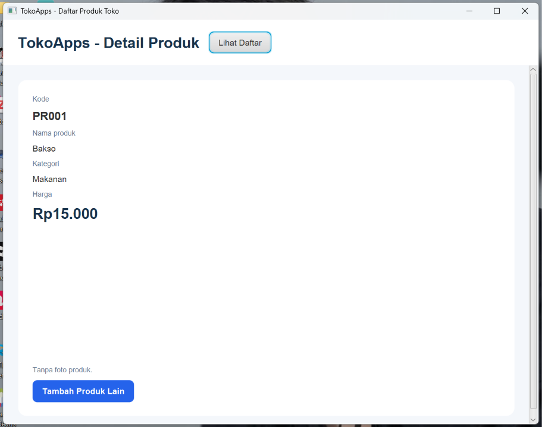
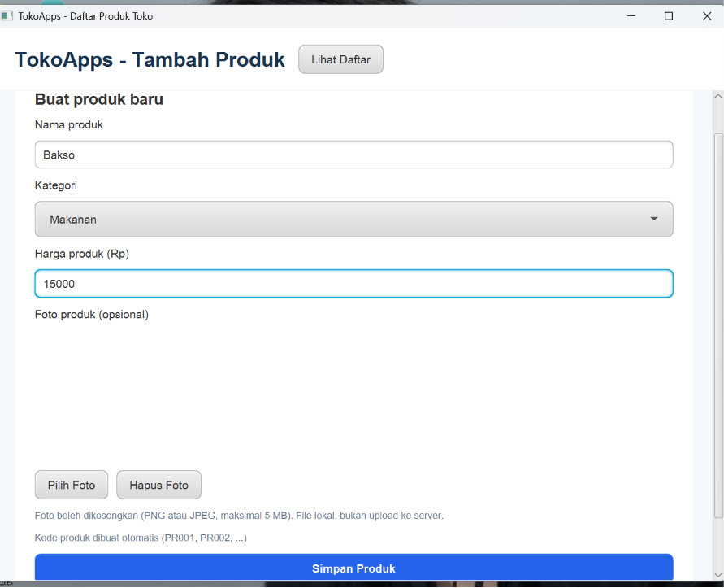
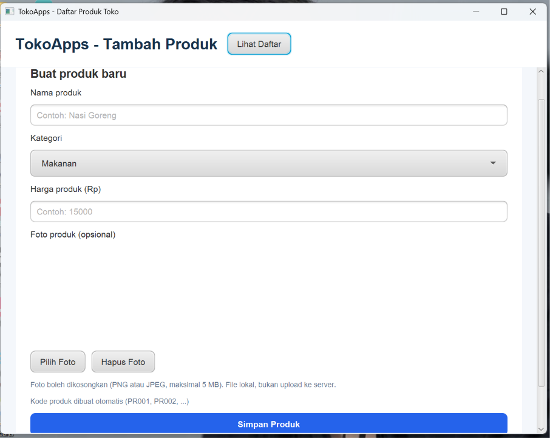
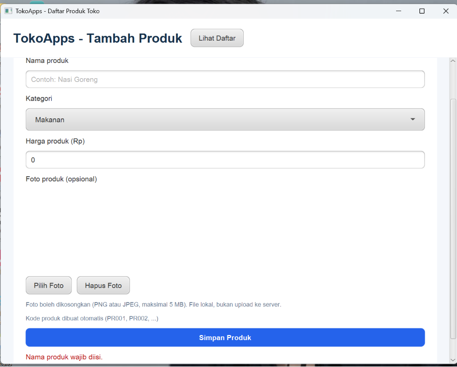

# TokoApps

Tugas individu pemrograman: aplikasi pencatatan produk toko berbasis JavaFX.

## Fitur
- Form untuk menambahkan produk (nama, kategori Makanan/Minuman, harga, foto opsional).
- Tabel daftar produk: kode, nama, kategori, dan harga.
- Pencarian produk berdasarkan nama melalui tombol **Cari**.
- Tombol **Lihat Detail** untuk membuka halaman detail produk yang dipilih.
- Validasi: nama produk tidak boleh kosong dan harga harus lebih dari nol.

## Screenshot

### Form tambah produk (kosong)

### Form tambah produk (terisi)

### Daftar produk dan pencarian

### Detail produk

### Validasi (nama kosong / harga tidak valid)

## Struktur proyek
- `kelas.model.Produk` : model produk (atribut private, constructor, getter).
- `kelas.data.DataProduk` : penyimpanan data selama aplikasi berjalan.
- `kelas.controller` : `FormController`, `DaftarController`, `DetailController`.
- `kelas.Navigator` : perpindahan antar halaman.
- `src/main/resources/kelas` : file FXML dan CSS.

## Cara menjalankan
1. Pastikan terpasang JDK 17 atau lebih baru dan Maven (JavaFX 21 diunduh otomatis lewat Maven).
2. Clone atau unduh repository ini: `git clone https://github.com/delia0910/TokoApps.git`
3. Buka proyek di NetBeans, lalu klik kanan proyek dan pilih **Run** (kelas utama: `kelas.MainApp`).
4. Atau lewat terminal di folder proyek: `mvn clean javafx:run`

Data produk hanya disimpan selama aplikasi berjalan (tanpa database).

## Pengujian
Masukkan minimal tiga produk, lalu cek bahwa semua muncul di tabel, pencarian menampilkan produk yang sesuai, **Lihat Detail** menampilkan produk yang dipilih, dan nama kosong atau harga tidak valid ditolak.
